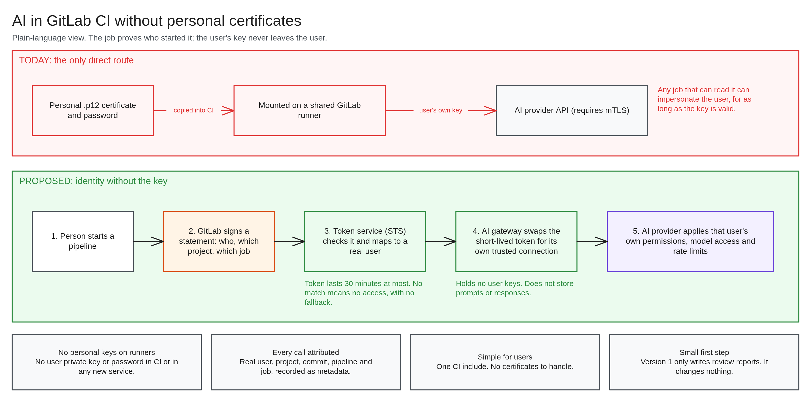
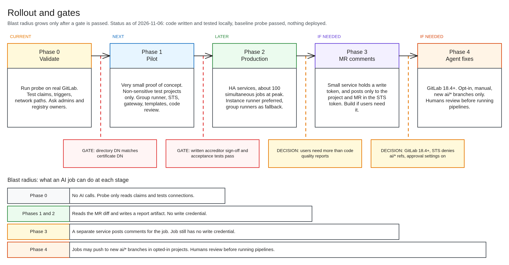

# Leadership brief: AI in GitLab CI without personal certificates

**Status, 2026-11-06:** Design approved. Initial code written and tested locally, with mapping and fork rules set. Baseline probe passed. Nothing is deployed: the remaining probe tests and working assumptions must be confirmed first.
**Ask:** Approve a small pilot on non-sensitive test projects, and sponsor two decisions outside the team (below).

## Bottom line

Teams want AI in CI jobs, starting with automated code review. Our AI provider requires each user's personal mTLS certificate, and putting that on a shared runner would expose the key to CI jobs.

We propose a token service and gateway that let a job use AI under the identity of the person who started it, with no personal key or password on a runner or in any new service. Users add one CI include and never handle a certificate.

**What this is not:** it gives attribution, not cryptographic non-repudiation. GitLab vouches for the user, and the user's private key signs nothing. The accreditor must accept this in writing before production.

## Why it matters

- **Code review** is the largest expected benefit.
- **Scheduled automation** for users who have nowhere else to run it.
- **Reuse:** other internal services could use the same token service later, after a security review of each.
- **Less key exposure:** teams get a supported route that doesn't involve mounting personal certificates.

## Risk posture

| Topic | Position |
|---|---|
| **User keys** | None on runners or in new services |
| **Attribution** | Every call is linked to a real user, project, commit, pipeline and job |
| **Permissions** | The provider still applies each user's own permissions, models and rate limits |
| **Data** | No new component stores prompts or responses. AI use is capped at GitLab's classification level |
| **First release** | Jobs only write review reports. They hold no write credential and change nothing |

### Risks we would be accepting

1. **Identity follows who triggered the job, not who wrote the code.** A malicious commit can act as whoever runs it, for up to 30 minutes.
2. **GitLab admins are in the trust boundary,** and are outside our team. One who changed a user's email could redirect that user's attribution. Audit logs would show the same user ID with a different DN.
3. **The gateway certificate and token signing key are powerful.** Either could claim to be any user, so both need strong protection.
4. **No content screening.** Prompt injection is limited only by restricting what jobs can do.
5. **Audit shows who, when and where, but not what was sent.** That is deliberate, given the data involved.

## Rollout

| Phase | Outcome | Gate to pass first |
|---|---|---|
| **0. Validate (current)** | Probe confirms our GitLab supports this. Initial code is written | None |
| **1. Pilot** | Very small proof of concept, non-sensitive test projects only | Directory DN matches the certificate DN, and working assumptions confirmed |
| **2. Production** | About 100 simultaneous jobs at peak | Written accreditor sign-off, and acceptance tests pass |
| **3. MR comments** | Findings posted as comments | Users need more than reports |
| **4. Agent fixes** | Opt-in fixes on separate branches | GitLab 18.4+, plus added safeguards |

## Decisions needed

| # | Decision | Who | Why now |
|---|---|---|---|
| 1 | Approve the pilot on non-sensitive test projects | Leadership | Starts once the probe passes |
| 2 | Sponsor the accreditor review | Leadership, accreditor | Sign-off is pending, and blocks production |
| 3 | Sponsor an instance runner request | Leadership, GitLab admins | Best route to all users. Answer still pending. Fallbacks exist |
| 4 | Commit platform team capacity to run the token service and gateway | Platform lead | Production needs both highly available |

**Recommended route:** pilot on group runners in a group we own, then request an instance runner for production. See the [options brief](options-decision-brief.md).

## Not yet known

- **Whether the design fully works on our GitLab.** Code was written on stated assumptions so the team could move ahead. The remaining probe tests decide whether they hold, and deployment waits on them. A false assumption means rework, not exposure.
- **Cost, staffing and schedule.** Not estimated yet. Pilot load data will inform sizing.
- **Accreditor position.** If refused, high-risk projects would need signed user delegation, which adds certificate handling for those users.
