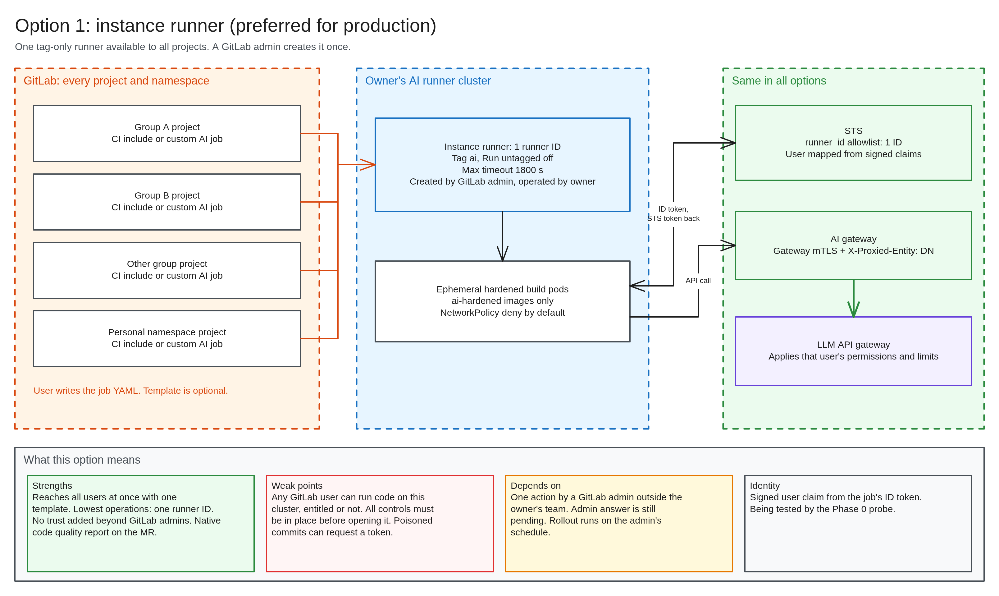
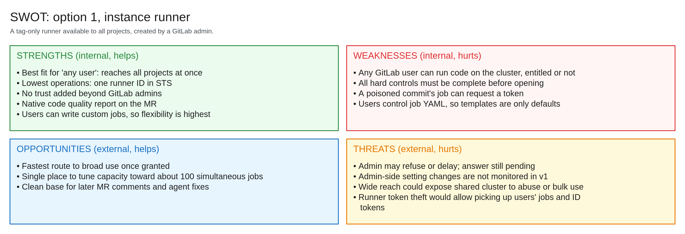
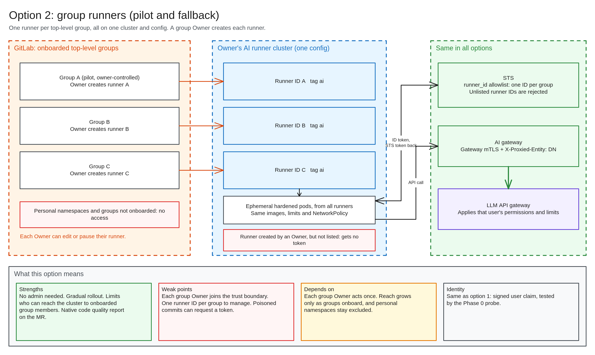
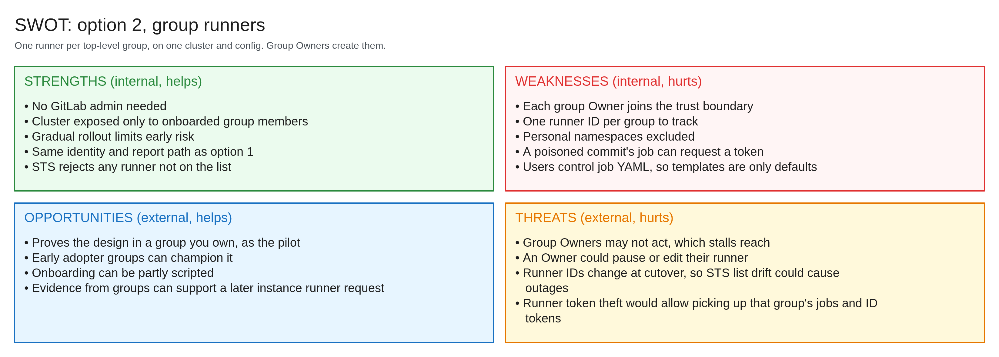
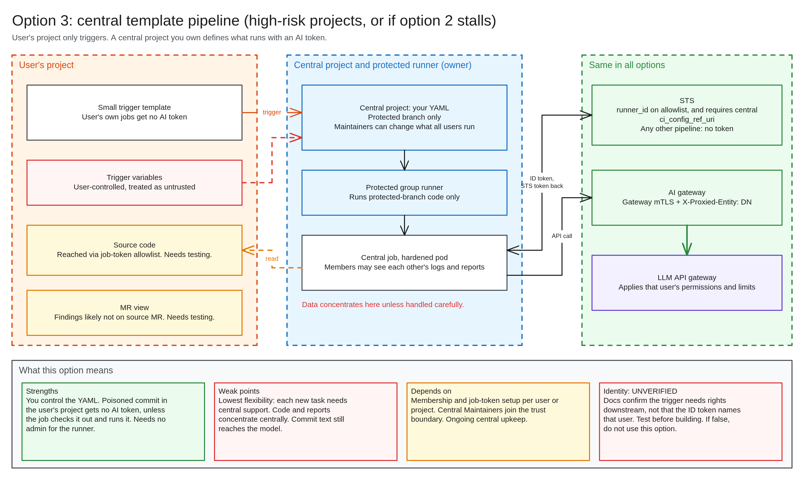
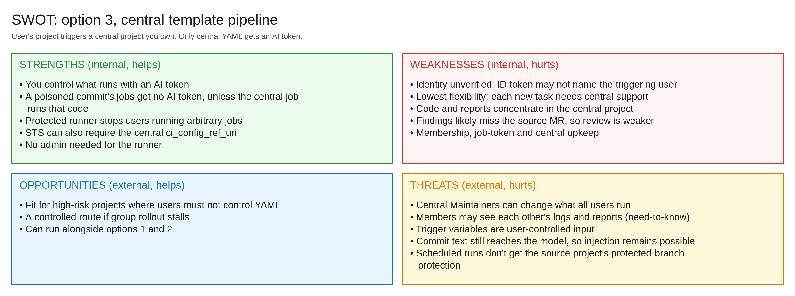
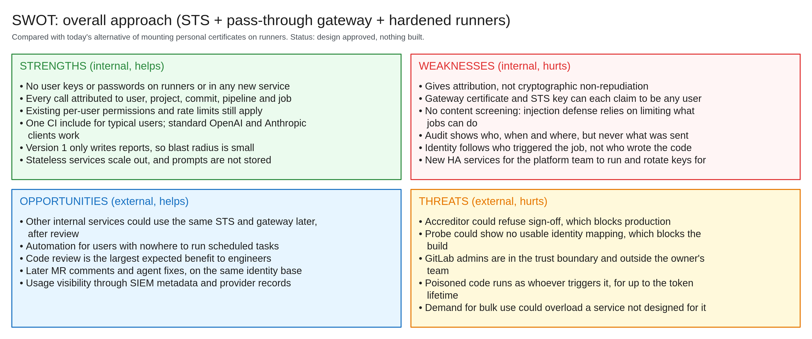

# Options brief: how CI jobs reach the AI runners

**Decision:** Which access options to use for the pilot and production.
**Recommendation:** Pilot on option 2, request option 1 for production, and keep option 3 for high-risk projects or if option 2 stalls.

The token service, gateway and provider are the same in every option. The options differ in how a job reaches our runner, and who controls what that job runs.

## At a glance

| | 1. Instance runner | 2. Group runners | 3. Central template pipeline |
|---|---|---|---|
| **Best for** | Production, all users | Pilot and fallback | High-risk projects |
| **Reach** | All projects | Onboarded groups only | Users granted access |
| **Outside help** | One GitLab admin action | Each group Owner, once | None for the runner. Access setup per user or project |
| **Who controls job YAML** | Each user | Each user | Us |
| **Custom AI jobs** | Yes | Yes | No |
| **Trust added beyond GitLab admins** | None | Each group Owner | Central project Maintainers |
| **Who can run code on our cluster** | Any GitLab user | Members of onboarded groups | Protected-branch code only |
| **Poisoned commit in user's project** | Weak: can request a token | Weak: can request a token | Stronger: gets no AI token, unless the job runs that code. Its text still reaches the model |
| **Report on the MR** | Native | Native | Likely not. Needs testing |
| **Identity** | Signed user claim, being tested | Same as option 1 | **Unverified.** Must be tested |
| **Operations** | Lowest | One runner ID per group | Access management and central upkeep |

Options can run together. The [design](../superpowers/specs/2026-11-05-gitlab-runner-ai-access-design.md) section 8.1 has the full comparison.

## Recommended sequence

1. **Pilot on option 2,** in a group we own. This needs nobody else's approval and uses non-sensitive test projects only.
2. **Request option 1 for production,** because it best fits "any user" and has the lowest upkeep.
3. **If refused, roll out option 2** group by group.
4. **Use option 3** where users must not control job YAML, or if option 2 stalls. Build it only when one of those cases arises, and only after its identity test passes.

**Rejected:**
- **Project runners:** enabling one needs Maintainer on both projects, and anyone who can edit it from an enabled project changes it for all.
- **Existing shared runners:** they remove our image, network and isolation controls.
- **Mounting personal certificates:** this exposes the keys the project exists to protect.
- **Central key storage:** a service holding every key could have made any signature.

## Option 1: instance runner

## Option 2: group runners

## Option 3: central template pipeline

## Overall approach

This SWOT covers the approach as a whole. Its strengths and weaknesses come from the design. Some opportunities and threats, in this and the option charts, are the author's judgment and are open to challenge.

