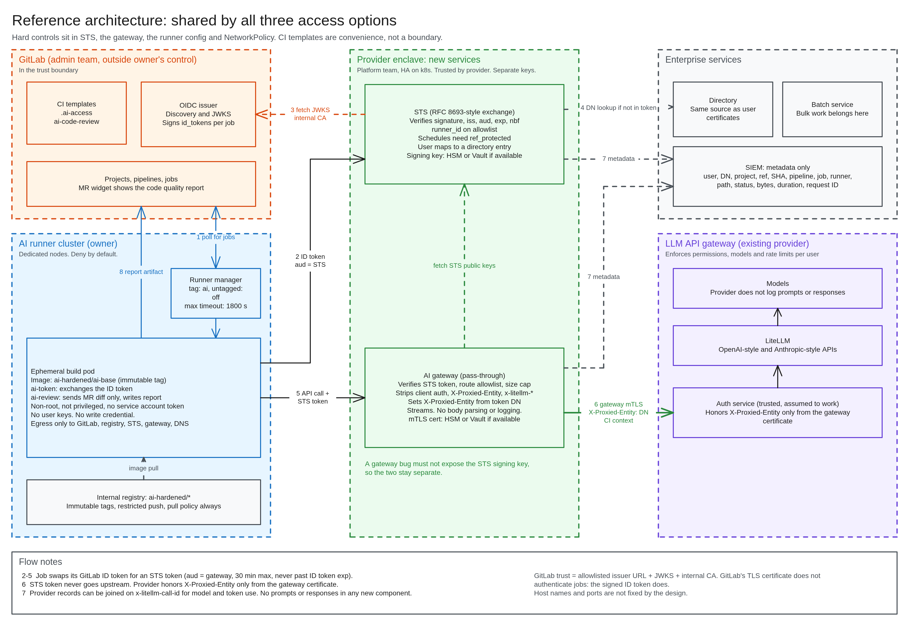
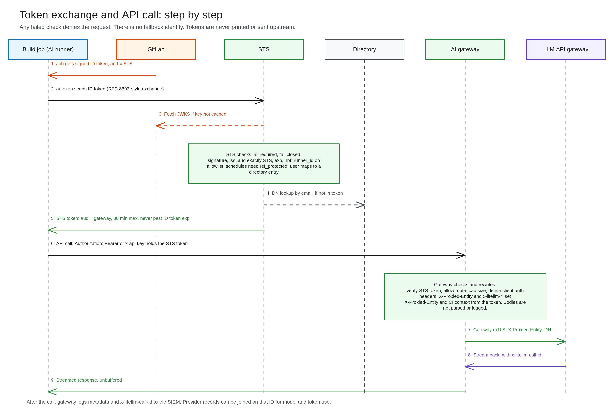
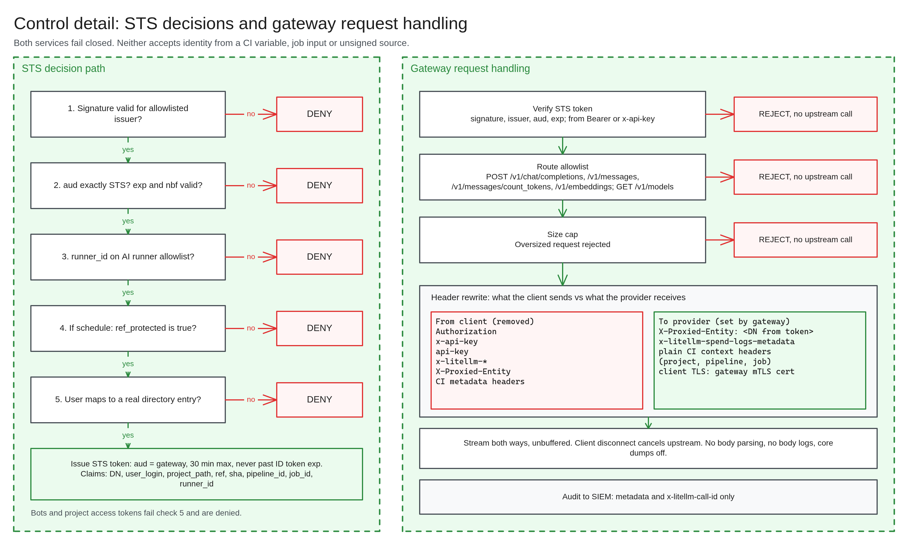
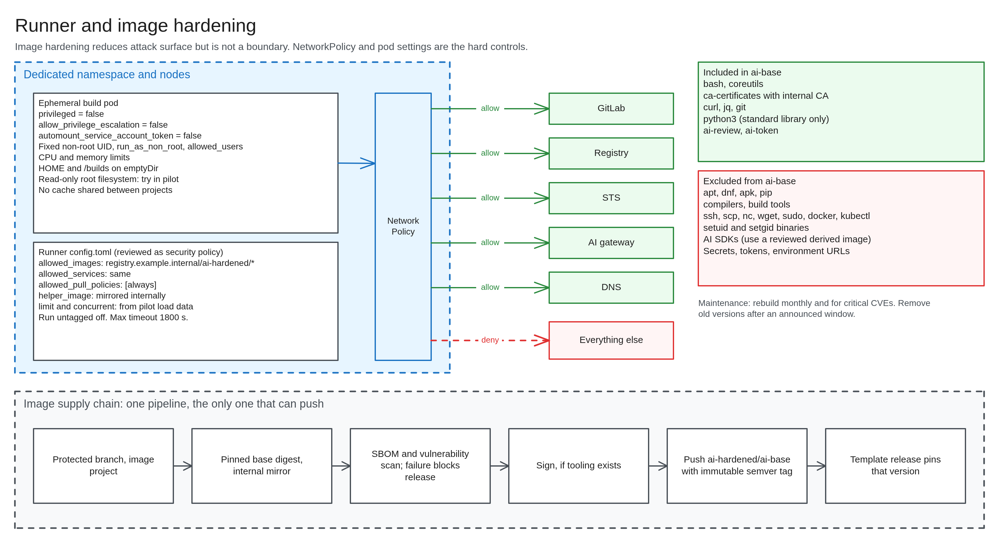

# Peer technical brief: GitLab runner AI access

**For:** engineers reviewing the design.
**Status, 2026-11-06:** Design approved, Phase 0 probe written, not yet run on our GitLab. Nothing else built.
**Sources:** [design](../superpowers/specs/2026-11-05-gitlab-runner-ai-access-design.md), [plan](../superpowers/plans/2026-11-05-gitlab-runner-ai-access.md), [probe](../../probe/README.md).

## Design in brief

A job swaps its GitLab ID token at STS for a short-lived token. A pass-through gateway verifies that token, then calls the LLM API gateway with its own mTLS certificate and `X-Proxied-Entity: <DN>`. The provider applies that user's permissions.





## Controls

Hard controls sit outside the job. Templates are convenience, and users may write their own jobs under options 1 and 2.

```text
Not on an AI runner  → STS refuses a token (signed runner_id)
Image not allowed    → runner refuses the job (allowed_images)
On an allowed image  → NetworkPolicy limits connections
```





## Key values

| Item | Value |
|---|---|
| **STS token** | `aud` is the gateway only, 30 minutes at most, never past the ID token's `exp` |
| **Runner** | Tag `ai`, Run untagged off, maximum timeout 1800 s |
| **Allowed routes** | `POST /v1/chat/completions`, `/v1/messages`, `/v1/messages/count_tokens`, `/v1/embeddings`. `GET /v1/models` |
| **Token headers accepted** | `Authorization: Bearer` or `x-api-key` |
| **Removed from clients** | `Authorization`, `x-api-key`, `api-key`, `x-litellm-*`, `X-Proxied-Entity`, CI metadata headers |
| **Mapping** | DN from `user_identities` if present, else directory lookup by `user_email`. No match means deny |
| **v1 output** | Code quality artifact. No write credential in the job |

**Why a code quality artifact:** `CI_JOB_TOKEN` can't post MR notes, protected variables don't reach normal MR pipelines, and the MR author can read unprotected ones. So v1 uses a native report that needs no write credential.

## Implementation choices open to challenge

- **Go with `golang-jwt` for STS and gateway:** chosen for its streaming proxy and single static binary. An existing reverse proxy is also allowed by the design. Needs a Go toolchain and module mirror on our network.
- **10 MiB request cap and 200 KiB review diff limit:** to tune in the pilot.
- **Route allowlist:** blocks `/v1/responses` because its stored state may conflict with the no-capture rule.
- **`allow_failure: true` on review:** an AI outage must not block merges.
- **Fork MRs skipped by the template:** this is a default, not a hard control.

## Known limits

- Poisoned code runs as whoever triggers it, for up to the token lifetime.
- Retrying someone else's commit runs their code under your identity. Logs record the SHA so an audit can separate the two.
- The gateway certificate and STS signing key can each claim to be any user.
- GitLab admins are in the trust boundary. Admin-side runner changes aren't monitored in v1.
- No content inspection. Injection defense relies on limiting what a job can do.
- Audit is metadata only. Nobody can later show what was sent, by design.
- Hardening the image is not a boundary, since a job can still run what is in its checkout.

## Still to prove

| Assumption | How it gets tested |
|---|---|
| Token has a DN or directory lookup key (**the build gate**) | Phase 0 probe |
| `user_login` matches expectations for push, MR, retry, manual, schedule, trigger token and bot | Phase 0 trigger test |
| `exp` tracks job timeout | Phase 0 probe |
| Runners reach the enclave; STS reaches JWKS and the directory | Phase 0 network test |
| `X-Proxied-Entity` format is a DN | Pilot gateway test |
| OpenAI and Anthropic clients work with the STS token as API key, including streaming | Pilot gateway test |
| Code quality widget is available on our tier | Test MR |
| Tokens and prompts stay out of logs with `CI_DEBUG_TRACE` on | Pilot test |
| Option 3: ID token names the triggering user | Test before building option 3 |

## What we want from reviewers

1. Ways to get a token for another user, or to reach the provider without going through STS.
2. Claims or assumptions that may not hold on our GitLab version.
3. Gaps in the acceptance tests (design section 14).
4. Whether an existing reverse proxy would be better than building the gateway.
